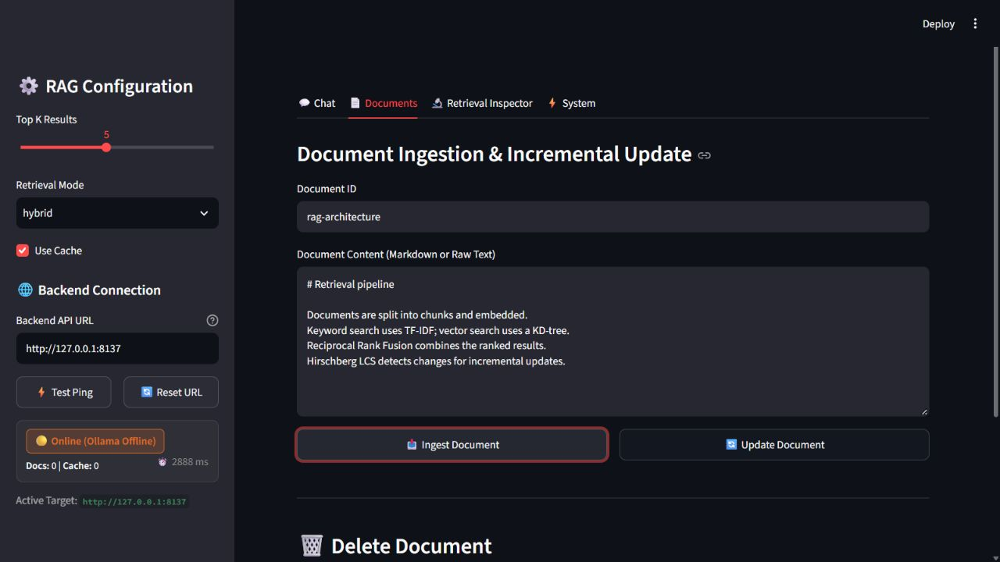

# Distributed RAG System

A document question-answering system with custom sharded caching, hybrid retrieval, and incremental document updates.

**Stack:** Python · FastAPI · Streamlit · NumPy · Sentence Transformers · Ollama

[Live demo](https://distributed-rag.streamlit.app/) · [Deployment guide](README_DEPLOY.md)

## Preview



Local document-management view; Ollama generation is offline in this capture.

## Engineering highlights

- **Hybrid search:** a custom TF-IDF inverted index and KD-tree combine keyword and embedding matches across retrieval shards.
- **Sharded cache:** consistent hashing, LRU eviction, and frequency/recency-based eviction keep repeated queries inexpensive.
- **Incremental updates:** Hirschberg LCS identifies changed document chunks for re-indexing.
- **Local generation:** Ollama answers from retrieved context and returns ranked sources.

`Document → chunks + embeddings → hybrid index → retrieval → Ollama → answer + sources`

Cache and retrieval shards run within one Python service using threads; indexing and caching are implemented without a vector database.

## Run locally

Requires Python 3.11+ and a running Ollama service. From the repository root:

```bash
pip install -r requirements.txt
ollama pull qwen2.5-coder:1.5b
python run.py
```

Open the [UI](http://localhost:8501) or [API docs](http://localhost:8000/docs). Ingest a document, ask a question, then inspect the retrieved sources.

## Explore the code

[Cache](cache/cache_engine.py) · [Retrieval](retrieval/retrieval_engine.py) · [Document diff](diff/diff_engine.py) · [RAG pipeline](pipeline/rag_pipeline.py)
